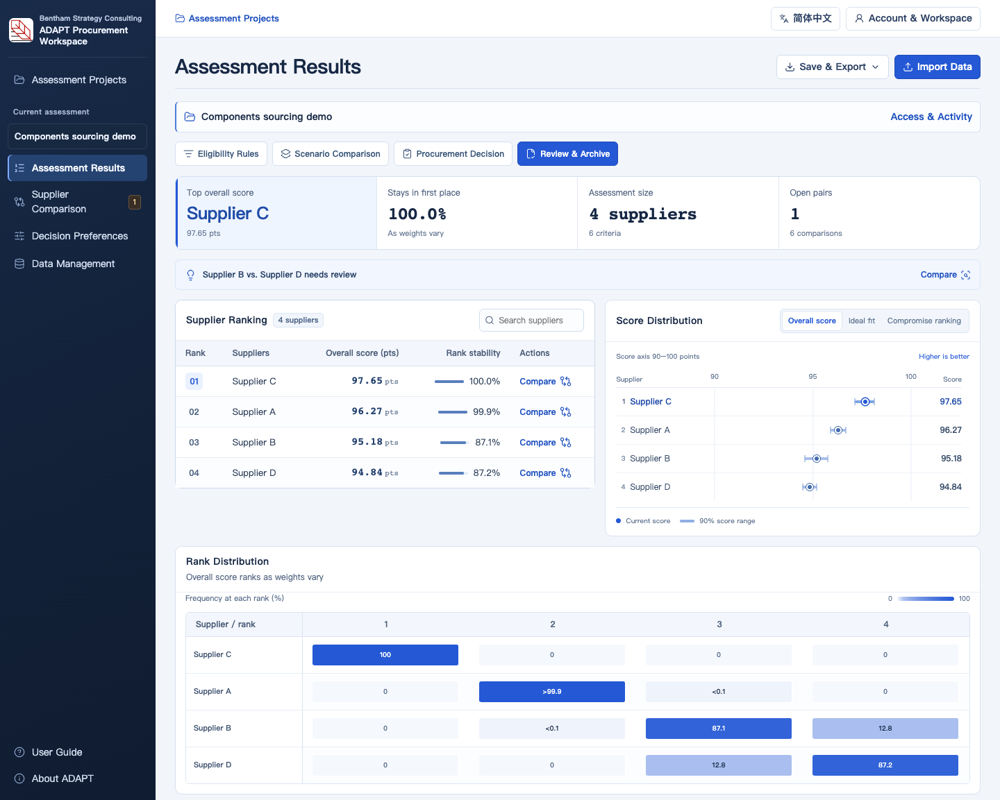

# ADAPT Procurement Workbench

Compare suppliers, see how changes in criteria weights affect rankings, and archive approved assessments as procurement review reports.

**[Download for Windows](https://github.com/365onlyforwork-code/adapt-supplier-workbench/releases/download/v1.0.0/ADAPT-v1.0.0-Windows.zip)** · **[Download for macOS](https://github.com/365onlyforwork-code/adapt-supplier-workbench/releases/download/v1.0.0/ADAPT-v1.0.0-macOS.zip)** · [Release notes](https://github.com/365onlyforwork-code/adapt-supplier-workbench/releases/tag/v1.0.0)

## Quick start

1. Download the ZIP for your operating system and extract the entire archive.
2. On Windows, double-click `Start ADAPT.cmd`. On macOS, double-click `Start ADAPT.command`. Both packages include the runtime.
3. When the browser opens, sign in as `admin` with the password shown in the launch window. Keep that window open while using the workbench.



*Assessment results using synthetic supplier data.*

## Procurement workflow

1. Fill in the Supplier Data sheet in the Excel template, or import an XLSX, CSV, or TSV file.
2. Create an assessment. Check supplier names, whether higher or lower values are preferred for each criterion, and the weights. Generate scores and rankings.
3. Check eligibility, compare suppliers, and save weighting scenarios as needed.
4. Record the recommended supplier and the rationale, then submit the assessment to the responsible reviewer.
5. After approval, download the A4 PDF for the archived version from **Review & Archive**.

The workbench supports account approvals, project permissions, activity records, and exports. The interface is available in English and Simplified Chinese. Project data is stored in the local SQLite database.

## Run from source

Use Node.js 24 or later. The local server uses Node.js's built-in SQLite support. From the repository root, run the commands below in a POSIX shell. Enter an initial administrator password with at least 12 characters when prompted.

```sh
export ADAPT_BOOTSTRAP_OWNER_EMAIL=admin@example.invalid
export ADAPT_PASSWORD_PEPPER="$(openssl rand -hex 32)"
printf 'Initial administrator password: '
IFS= read -rs ADAPT_BOOTSTRAP_PASSWORD
printf '\n'
export ADAPT_BOOTSTRAP_PASSWORD
node scripts/start.mjs
```

Open `http://127.0.0.1:3000` and sign in as `admin` with the password you configured. Use `PORT` to change the port. The database defaults to `.data/adapt.sqlite`, and Git excludes the `.data/` directory.

Store `ADAPT_PASSWORD_PEPPER` in a private environment variable or a secret store and reuse the same value for that database. After creating the administrator, you can restart with the existing password pepper. The browser and the server run on the same machine, and the server listens on `127.0.0.1`.

## Tests and documentation

```sh
node --test tests/*.test.mjs
```

- [User guide](docs/USER-GUIDE.md)
- [Demonstration walkthrough](docs/DEMO.md)
- [Project and technical notes](docs/PROJECT.md)
- [Test report](docs/TEST-REPORT.md)
- [Release maintenance](docs/RELEASE.md)
- [Changelog](CHANGELOG.md)
- [Third-party notices](THIRD_PARTY_NOTICES.md)

Created by **Yanbing Min** · Beihan Strategy Consulting
